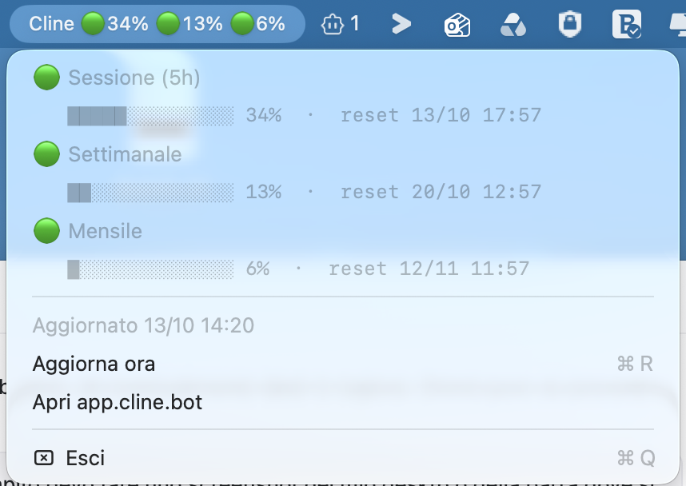

# ClineQuota

A tiny macOS menu bar app that shows your **Cline Pass** quota usage in real time — always visible, no need to dig into the Cline GUI.


That's: **5-hour session / weekly / monthly** utilization, refreshed automatically.

Clicking the menu bar item shows progress bars, reset times, and quick actions:



- 🟢/🟠/🔴 traffic-light indicator per quota (thresholds: 70% / 90%)
- Progress bar + exact reset date/time for each window
- **Aggiorna ora** (Refresh now)
- Link to [app.cline.bot](https://app.cline.bot)

## Why

Cline's native account panel is buried in the extension UI. This app polls the official API
(`api.cline.bot/api/v1/users/me/plan/usage-limits`) and keeps the numbers in your macOS menu bar,
visible over every window.

## Requirements

- macOS (tested on macOS 26)
- **Xcode Command Line Tools** — needed only to build from source:
  ```bash
  xcode-select --install
  ```
- A Cline account with an active **Cline Pass** (or free tier) plan

## Installation

### Option A — Download the prebuilt app (easiest)

1. Download `ClineQuota.app.zip` from the
   [latest release](https://github.com/Acwildweb/cline-quota-menubar/releases/latest)
2. Unzip it and move `ClineQuota.app` wherever you like (e.g. `~/Applications`)
3. The binary is **not code-signed**, so macOS Gatekeeper will block the first launch.
   Either right-click → **Open** → **Open**, or run once:
   ```bash
   xattr -dr com.apple.quarantine /path/to/ClineQuota.app
   ```
4. Launch it:
   ```bash
   open /path/to/ClineQuota.app
   ```

### Option B — Build from source (recommended for developers)

```bash
git clone https://github.com/Acwildweb/cline-quota-menubar.git
cd cline-quota-menubar
./build.sh
open ClineQuota.app
```

### Start at login (optional)

```bash
osascript -e 'tell application "System Events" to make login item at end with properties {path:"/full/path/to/ClineQuota.app", hidden:false}'
```

Or manually: **System Settings → General → Login Items → +** → select `ClineQuota.app`.

### Uninstall

Quit from the menu (**Esci**), delete `ClineQuota.app`, and remove the login item if you added it.

## Authentication

The app needs a token, resolved in this order:

1. **`CLINE_API_KEY` environment variable** — create one at
   [app.cline.bot](https://app.cline.bot) → Account → API Keys.
   To make it persistent, set it in a `launchctl setenv CLINE_API_KEY ...` call or your shell profile
   and launch the app from that context.
2. **Automatic (default)**: if you use the **Cline desktop app**, the OAuth token is read from
   `~/.cline/data/settings/providers.json`. Cline refreshes this token itself, so the app keeps
   working without any configuration.

No token is stored or sent anywhere except `api.cline.bot`.

## Configuration

| Environment variable | Default | Description |
|---|---|---|
| `CLINE_API_KEY` | _(unset)_ | Cline API key, overrides OAuth token |
| `CLINE_QUOTA_INTERVAL` | `60` | Poll interval in seconds |

## Notes

- The binary is **not code-signed**. If Gatekeeper blocks a downloaded build, run
  `xattr -dr com.apple.quarantine ClineQuota.app` — or just build from source (one command).
- If Cline desktop is not running when the OAuth token expires, the app shows ⚠️ until you open
  Cline once (it renews the token) or you set `CLINE_API_KEY`.

## Author & Credits

**Developer:** Gianfranco Ringo
**Company:** A.c. Wild S.a.s — Via Spagna, 33 · 90146 Palermo (Italy)
**Email:** info@acwild.it · **Web:** https://www.acwild.it

This app was designed and built with the technical assistance of
**[Cline](https://cline.bot)** — the AI coding agent — using the Cline desktop app
and its official API (`api.cline.bot`).

## Contributing

Issues and PRs welcome — e.g. localization (currently Italian labels),
notifications at thresholds, credit balance display.

## License

MIT
